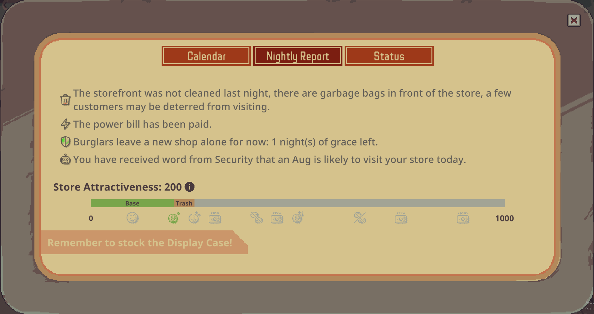
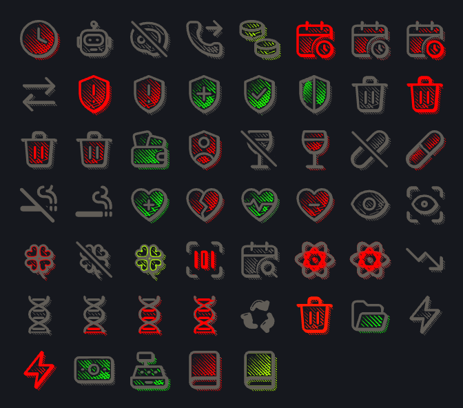

# BETTER NIGHTLY REPORT

Better Nightly Report has one feature, to make the nightly report, better!
## Install
### Steam Workshop
- Subscribe in steam workshop.

- Activate the mod 'Better Nightly Report' in the game's mod menu.
## Build from Git
- You need the [.NET SDK](https://dotnet.microsoft.com/download) 6.0 or later.
- Clone repo into your game install folder.
```bash
dotnet build -c Release
```
- Build is in Mods\BetterNightlyReport
## Versions
### 0.1.0
- Added Icons for rach event in the nightly log.
## Icons

The mod uses modified versions of the following icons libraries.
### Withicons
https://github.com/withevergrow/withicons

>MIT License
>
>Copyright (c) 2026 with icons contributors
>
>Permission is hereby granted, free of charge, to any person obtaining a copy
>of this software and associated documentation files (the "Software"), to deal
>in the Software without restriction, including without limitation the rights
>to use, copy, modify, merge, publish, distribute, sublicense, and/or sell
>copies of the Software, and to permit persons to whom the Software is
>furnished to do so, subject to the following conditions:
>
>The above copyright notice and this permission notice shall be included in all
>copies or substantial portions of the Software.
>
>THE SOFTWARE IS PROVIDED "AS IS", WITHOUT WARRANTY OF ANY KIND, EXPRESS OR
>IMPLIED, INCLUDING BUT NOT LIMITED TO THE WARRANTIES OF MERCHANTABILITY,
>FITNESS FOR A PARTICULAR PURPOSE AND NONINFRINGEMENT. IN NO EVENT SHALL THE
>AUTHORS OR COPYRIGHT HOLDERS BE LIABLE FOR ANY CLAIM, DAMAGES OR OTHER
>LIABILITY, WHETHER IN AN ACTION OF CONTRACT, TORT OR OTHERWISE, ARISING FROM,
>OUT OF OR IN CONNECTION WITH THE SOFTWARE OR THE USE OR OTHER DEALINGS IN THE
>SOFTWARE.

### Google Material Design Icons
https://fonts.google.com/icons

## Planned Features
- Better attractiveness indicators and UI
- Interop with other mods that use the NightLog system

## Bug reports and suggestions

### Git Issues page
### Steam Workshop comments
### Official Discord